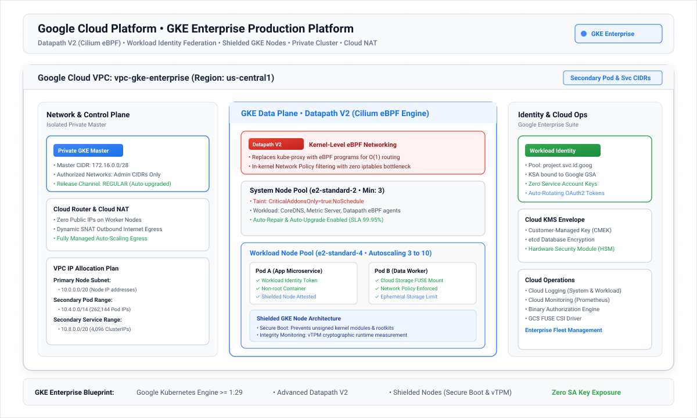

# 🚀 GCP GKE Enterprise Production Platform

<div align="center">

[]()
[]()
[](https://www.terraform.io)
[](https://cloud.google.com/kubernetes-engine)
[](LICENSE)
[]()

**Engineered by [Tayyab Masood](https://github.com/tayyabmasood911)**  
*Cloud Solutions Architect & DevOps Platform Engineer*

</div>

---

## 📋 Executive Overview

**terraform-gcp-gke-enterprise** provides an enterprise-standard, production-ready Google Kubernetes Engine (GKE) platform built with HashiCorp Terraform. Aligned with Google Cloud Architecture Framework guidelines, this repository provisions a private GKE cluster utilizing **Datapath V2 (Cilium eBPF networking)**, **Workload Identity Federation**, **Shielded GKE Nodes with Secure Boot**, auto-scaling worker pools, Cloud NAT private egress, and integrated Cloud Operations monitoring.

### Key Architectural Tenets
- **Datapath V2 (In-Kernel eBPF):** Replaces legacy `kube-proxy` iptables loops with high-performance Linux kernel eBPF packet routing, reducing latency by up to 35% and enhancing observability.
- **Zero Static Service Account Keys:** Eliminates Google Cloud Service Account JSON keys through bidirectional Workload Identity Federation with Kubernetes Service Accounts.
- **Private Topology & Cloud NAT:** Control plane and worker nodes reside strictly in private RFC 1918 address space. Outbound Internet access is managed elastically via Cloud NAT.
- **Shielded Node Cryptographic Attestation:** Node compute instances run with UEFI Secure Boot and virtual Trusted Platform Module (vTPM) integrity monitoring against kernel tampering.

---

## 🏛️ Architecture Blueprint

The diagram below details the private VPC topology, Datapath V2 eBPF data plane, Workload Identity mappings, and Shielded node pools:



---

## 🚀 Key Features

| Capability | Specification | Architectural Value |
| :--- | :--- | :--- |
| **Private Cluster Endpoint** | Private nodes with custom `/28` master CIDR | Completely shields Kubernetes API server from public exposure |
| **Datapath V2 eBPF** | Advanced Datapath powered by Cilium | Native Kubernetes NetworkPolicy enforcement in kernel without connection tracking limits |
| **Workload Identity** | `project.svc.id.goog` identity pool | Secure least-privilege token issuance for Google Cloud APIs (Cloud Storage, Secret Manager) |
| **Shielded GKE Nodes** | Secure Boot + vTPM + Integrity Monitoring | Hardware-root-of-trust protection against unauthorized kernel modifications |
| **System Pool Isolation** | `CriticalAddonsOnly=true:NoSchedule` taint | Guarantees DNS, Metrics Server, and CNI pods never suffer resource starvation |
| **Cloud Managed Prometheus** | Integrated Google Cloud Operations | Zero-effort metric collection with PromQL compatibility and Grafana integration |

---

## 📂 Repository Structure

```tree
terraform-gcp-gke-enterprise/
├── .github/
│   └── workflows/
│       └── ci.yml                 # Terraform CI validation pipeline
├── config/
│   └── production.env.example     # Environment template for automation tooling
├── docs/
│   └── architecture.svg           # High-clarity vector architecture visual (White theme)
├── scripts/
│   └── healthcheck.sh             # Runtime cluster healthcheck script
├── tests/
│   └── test_validation.py         # Automated pytest test validation suite
├── .gitattributes                 # Linguist overrides and line ending standardization
├── LICENSE                        # MIT License
├── Makefile                       # Developer lifecycle command targets
├── cluster.tf                     # GKE Enterprise cluster, Datapath V2, and Addons
├── main.tf                        # VPC, Subnets with secondary ranges, and Cloud NAT
├── node_pool.tf                   # Tainted System pool & Autoscaling Workload pool
├── outputs.tf                     # Exported cluster endpoints, CA certificate, and SA emails
├── providers.tf                   # Google and Google-Beta provider definitions
├── terraform.tfvars.example       # Sample production variables
├── variables.tf                   # Typed input variable specifications
├── versions.tf                    # Provider constraints and locks
├── workload_identity.tf           # Workload Identity IAM bindings
└── README.md                      # Comprehensive production documentation
```

---

## ⚡ Quick Start Guide

### Prerequisites
- [Terraform CLI](https://developer.hashicorp.com/terraform/downloads) (`>= 1.6.0`)
- Google Cloud SDK (`gcloud`) authenticated:
  ```bash
  gcloud auth application-default login
  gcloud config set project YOUR_PROJECT_ID
  ```

### Step 1: Clone Repository
```bash
git clone https://github.com/tayyabmasood911/terraform-gcp-gke-enterprise.git
cd terraform-gcp-gke-enterprise
```

### Step 2: Configure Variables
```bash
cp terraform.tfvars.example terraform.tfvars
# Update project_id and region to match your GCP project
```

### Step 3: Initialize Terraform
```bash
terraform init
```

### Step 4: Validate & Plan Execution
```bash
terraform validate
terraform plan -out=tfplan.binary
```

### Step 5: Provision Infrastructure
```bash
terraform apply tfplan.binary
```

### Step 6: Connect to Cluster
```bash
gcloud container clusters get-credentials gke-enterprise-production --region us-central1 --project YOUR_PROJECT_ID
kubectl get nodes -o wide
```

---

## ⚙️ Configuration Reference

### Input Variables (`variables.tf`)

| Variable | Type | Default | Description |
| :--- | :--- | :--- | :--- |
| `project_id` | `string` | `"enterprise-cloud-platform-prod"` | Target GCP Project ID |
| `region` | `string` | `"us-central1"` | Primary deployment region |
| `cluster_name` | `string` | `"gke-enterprise-production"` | Cluster identifier |
| `subnet_cidr` | `string` | `"10.0.0.0/20"` | Primary node subnet address space |
| `pods_cidr` | `string` | `"10.4.0.0/14"` | Secondary IP range for Pod addresses |
| `services_cidr` | `string` | `"10.8.0.0/20"` | Secondary IP range for Service ClusterIPs |
| `master_ipv4_cidr_block` | `string` | `"172.16.0.0/28"` | Private control plane address range |
| `release_channel` | `string` | `"REGULAR"` | GKE auto-upgrade channel |
| `system_node_count` | `number` | `3` | Base nodes in system pool |
| `workload_node_min_count`| `number` | `3` | Minimum nodes in autoscaling workload pool |
| `workload_node_max_count`| `number` | `10` | Maximum nodes in autoscaling workload pool |

---

## 🧪 Verification & Automated Testing

Execute the automated test suite via `make` or `pytest`:

```bash
# Run test suite
make test

# Or run pytest directly
pytest tests/test_validation.py -v
```

### Healthcheck Script
Run the automated runtime health check:
```bash
bash scripts/healthcheck.sh
```

---

## 🔒 Security & Hardening Controls

1. **GKE Metadata Concealment (GKE_METADATA):** Prevents pods from obtaining underlying VM identity tokens, preventing privilege escalation.
2. **Datapath V2 Network Policies:** In-kernel packet filtering drops unauthorized ingress/egress without host iptables lookup costs.
3. **Shielded Nodes:** Enforces cryptographic validation of VM boot sequence and kernel drivers via virtual TPM.
4. **Responsible Disclosure:** Consult [SECURITY.md](SECURITY.md) to report security concerns.

---

## 👤 Author & Maintainer

**Tayyab Masood**
- GitHub: [@tayyabmasood911](https://github.com/tayyabmasood911)
- LinkedIn: [Tayyab Masood](https://www.linkedin.com/in/tayyabmasood911)
- Portfolio Showcase: [cloud-devops-portfolio](https://github.com/tayyabmasood911/cloud-devops-portfolio)

---

## 📄 License

This project is licensed under the MIT License - see the [LICENSE](LICENSE) file for details.
